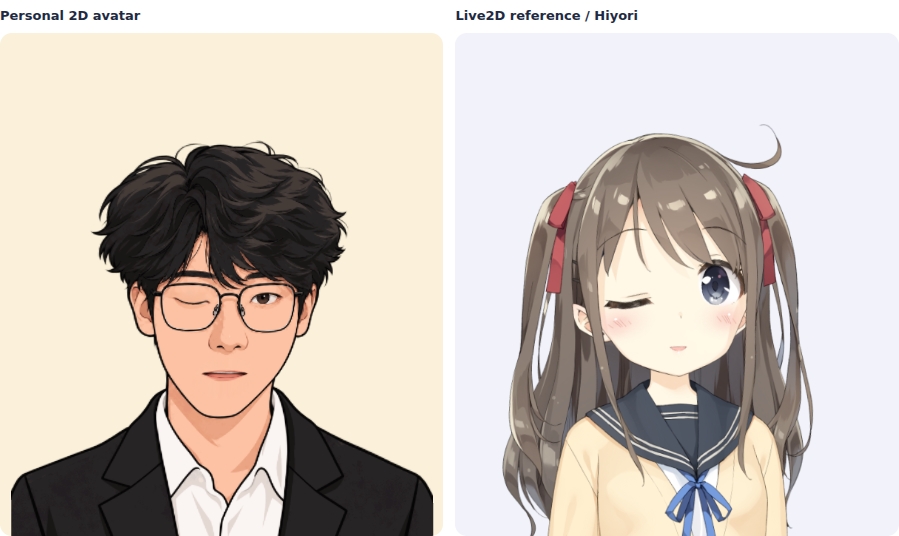

# 第五版：KalidoKit 映射与 Live2D 同步对照

启动（不需要安装 Python 依赖）：

```powershell
python run_avatar.py
```

访问 http://localhost:8000/avatar/ ，更新后按 Ctrl+F5 强制刷新。默认角色是已经制作并绑定的二维插画，无须配置 API 或安装额外 Python 库。先勾选“打开 Live2D 同步对照”，点自动演示确认两侧均能运动，再开启面捕。默认使用“参考 KalidoKit 官方映射”；需要按个人眼睛、嘴部比例调节时，再切换“个人校准映射”。



这张预览由真实渲染器输出手动预设动作，不是摄像头录屏。

## 这轮的重点

- 默认直接使用 KalidoKit 的眼睑、张嘴、嘴角、视线、眉毛与头部角度，调用官方 `stabilizeBlink`。头部以 30° 为统一映射范围，再按各渲染器参数范围限制。
- 加入真正的 Cubism / Pixi Live2D 对照，复用原仓库已有的 Hiyori 模型及其物理绑定。关闭对照后停止额外绘制，再次打开复用已加载模型。
- 两侧使用同一个 getUserMedia 流、一个 FaceMesh 实例、每次检测只调用一次 Face.solve，再共用同一份滤波后动作。Live2D 没有额外启动面捕、自动眨眼或鼠标跟随。
- 参考官方示例的头部到身体 0.3 跟随比例，可调到 0–0.5；身体参数限制为 ±10°。二维网格只支持身体 X/Z，Live2D 对照还支持身体 Y。网格与 Cubism 的 Z 参数符号相反，适配器分别转换，使屏幕上的歪头方向一致。
- 官方映射在应用层仅使用一层按时间计算的平滑，眼睛约 20 ms、嘴部约 25 ms、其他约 40 ms 的时间常数，避免依赖帧率的固定插值。它参考官方参数语义，并非逐行复刻官方 demo 的插值。
- 个人校准模式保留 One Euro 滤波，去掉应用层重复平滑，修正头部坐标约定，使两个映射的转头方向一致。个人模式仍有基线、眨眼滞回与突变限制。
- “动作诊断”显示头部角度、眼睛开度、张嘴及输入新鲜度；可导出当前数值快照，不含照片、视频、关键点或 API 密钥。
- 第四版保存在 `/avatar-v4/`，其运行时代码和原映射未改；共享原有插画、渲染器与 KalidoKit 文件。

这轮没有把个人插画转成 Cubism 模型。左侧依旧是二维网格与有限的眼睛、嘴部素材，右侧是专业绑定的样例。相同输入下仍有表现差异，可以据此区分检测/映射问题与素材绑定问题。两者的嘴型参数含义不同，网格将圆口/宽口映射到自己的形态轴，Live2D 使用 MouthOpenY 与 MouthForm。

## 对照组件与网络

Pixi 6.5.10、pixi-live2d-display 0.4.0 随仓库提供，来源与 MIT 许可见 `vendor/README-live2d.md`。Cubism Core 属于独立的专有运行库，不随本仓库分发。Hiyori 继续使用 fork 中原有的 `docs/models/hiyori/`。

运行 `python run_avatar.py` 时，首次打开对照，本机 `/api/live2d-core.js` 从固定的 Live2D 官方托管地址获取 Core，只缓存到当前 Python 进程内存；不会发送摄像头内容，不提供任意 URL 代理。后续开启对照不重复下载。此路径支持 urllib 使用的系统代理和 `HTTPS_PROXY`。纯静态服务会回退到浏览器直连官方托管地址。

如代理 HTTP/Mixed 端口为 7890，可在启动服务前设置（端口以代理客户端为准）：

```powershell
$env:HTTPS_PROXY = "http://127.0.0.1:7890"
python run_avatar.py
```

若仍无法获取，可从 https://www.live2d.com/zh-CHS/sdk/download/web/ 下载 SDK 后，将自己的 `Core/live2dcubismcore.min.js` 放到 `docs/avatar/vendor/live2dcubismcore.min.js`，展开“对照加载与重试”，勾选“使用本地 Core”，点重试。本地 Core 路径已加入 `.gitignore`。Core 加载失败时左侧插画和面捕继续运行。官方托管地址内容可能更新；可使用本地 SDK 文件固定版本。

## 保留的二维角色功能

- 接入 Mesh Avatar Studio 的 `mesh-avatar@0.2.1` WebGL2 运行时，分发文件随仓库提供，不必从 CDN 下载渲染器。上游代码原样保留，包含 MIT 许可和版本来源。
- 默认图由本次会话的照片与画风参考制作，已准备眼睛、嘴部、头部、眉毛和发丝的绑定。它是单独制作的角色素材，不是摄像头逐帧生成图像。
- 头部与五官使用带纹理的二维网格变形，保留原画线条、皮肤色块和发型细节。嘴部有绘制的开口素材与不同口型；眼睑有半闭、闭合与微笑状态。
- 可在原画平涂和可选的赛璐璐光影之间切换。光影使用 2.5D 法线近似，并不是完整三维模型的三渲二。
- 动画上限默认 30 帧，可选 60 帧；只绘制当前角色类型。页面显示实际动画频率与 JavaScript/图形命令提交耗时，后者不包含 GPU 完整执行时间。
- 可在本地导入 Mesh Avatar Studio 导出的 `.mavatar`，无需把角色上传给服务端。加载失败保留当前角色；WebGL2 不可用时回退到参数角色。
- “保存当前画面”导出当前所选渲染器的 PNG。参数滑块仅在参数角色模式显示，避免修改了却不影响插画。
- 使用 MediaPipe FaceMesh 478 点与 KalidoKit 1.1.5 的实际 Face.solve 求解姿态、眼睛、眉毛、视线、嘴型。
- 在个人校准模式下，开启面捕后保持正面、睁眼、闭嘴约 1–2 秒，采集至少 24 帧，建立个人中性表情。眼睑、嘴部开合与眉毛由关键点相对个人基线计算，头部姿态和视线继续由 KalidoKit 求解。
- 采用 One Euro 自适应滤波：静止时减小抖动，快速动作时提高跟随速度；眨眼有闭合/重新睁开的不同阈值，防止半闭眼反复跳动。头部和视线有突变限制，丢失人脸时回到中性表情。
- 跟踪上限可选 15、20、30 次/秒，默认 30；实际速度受设备和模型耗时影响，页面显示实际接收频率与处理耗时。另有个人校准模式的眨眼、张嘴、转头幅度调节；官方模式会禁用这些调节，并且无需校准。
- KalidoKit 随项目提供，保留其 MIT 许可头。FaceMesh 首次使用时从 CDN 下载。
- 原有拍照生成保留在“照片生成参数角色”中，生成成功会切到参数角色。它测量比例和近似肤色，不会自动生成当前这种插画或其绑定。
- DeepSeek 分析为可选项：在网页明确勾选后，仅在生成时向本机后端提交该照片，后端请求官方视觉 API，返回受限 JSON 外观参数。
- 所有表情驱动和显示在本地运行；DeepSeek 不参与逐帧动画。
- 第三版保存在 `/avatar-v3/`，第二版仍在 `/avatar-v2/`，可对照。

## 二维画风与转脸的边界

二维插画能通过局部透视与不同深度的位移表现轻侧脸、俯仰和歪头；单张正面图没有真正的侧面、后脑和遮挡信息，因此不支持完整侧脸或 360° 旋转。控制参数中的角度不应被当作重建出的真实观察角。

普通 PNG 需要先在 Mesh Avatar Studio 中划定眼睛、嘴部、头部等区域并构建图层，再导出 `.mavatar`。本页面不声称自动绑定任意 PNG。导入的角色只保留在当前会话，刷新后回到示例。

本版不会下载新的图像生成网络或在每帧进行生成推理。计算量来自关键点检测、姿态求解、网格变形与 WebGL 渲染；仍需在用户的摄像头和显卡上验证。卡顿时先使用 30 帧动画、15 或 20 次/秒跟踪，关闭额外光影。

素材制作与上游来源见 `character/ASSET_NOTES.md` 和 `vendor/README-mesh-avatar.md`。`tools/mesh-avatar/build-layers.py` 是离线素材处理工具，需要 Pillow、NumPy、OpenCV；运行本页面不需要安装这些依赖。

## DeepSeek 配置

当前没有接触或配置用户密钥，也没有执行真实付费 API 调用。

可以先验证动画与本地拍照效果。需要启用 AI 外观分析时，在启动服务的 PowerShell 中设置 `DEEPSEEK_API_KEY`。建议使用隐藏输入：

```powershell
$avatarSecret = Read-Host "DeepSeek API Key" -AsSecureString
$env:DEEPSEEK_API_KEY = [System.Net.NetworkCredential]::new('', $avatarSecret).Password
Remove-Variable avatarSecret
python run_avatar.py
```

密钥只保留在这个 PowerShell 进程的环境变量里，不写入前端、仓库或图片。停止后可运行：

```powershell
Remove-Item Env:DEEPSEEK_API_KEY
```

默认使用官方文档当前列出的视觉模型 `deepseek-flash`。如账户支持的模型名不同，通过 `DEEPSEEK_MODEL` 环境变量设置。必须选择支持图片输入的模型。

## 技术边界

插画模式和原有参数模式相互独立。DeepSeek 提取参数，不生成卡通 PNG，也不制作插画绑定。参数模式的发型目前有三种模板、服装结构固定。插画模式使用已绑定的素材，不能用参数模式的滑块改造发型。

已通过真实 Chromium 中的 WebGL 渲染、导入/失败保留、PNG 导出、光影切换、小屏布局、WebGL 不可用回退，以及模拟相机输入的校准驱动检查。真实 DeepSeek 返回效果与真实摄像头质量仍需用户本机验证。预览 GIF 由实际 WebGL 渲染器输出预设动作，不是摄像头录屏。

官方参考：

- https://github.com/yeemachine/kalidokit
- https://github.com/shinshin86/mesh-avatar-studio
- https://api-docs.deepseek.com/guides/vision/
- https://api-docs.deepseek.com/api/create-chat-completion/

## 回归检查

```powershell
python -m unittest discover -s tests -p "test_avatar_server.py"
node tests/avatar_model.test.js
node tests/avatar_tracking.test.js
node tests/avatar_app.test.js
node tests/avatar_mesh.test.js
node tests/avatar_kalido.test.js
```

这些检查不请求摄像头，也不调用真实 DeepSeek API。覆盖参数边界、关键点不被求解器污染、个人校准、眨眼滞回、动作响应、模拟拍照流程、镜像眼睛映射、素材格式验证和归档往返。

可选的浏览器回归：另行准备 Playwright 与 Chromium 后，运行 `node tests/avatar_browser.test.js`。可通过 `AVATAR_BROWSER_PATH` 指定浏览器程序，通过 `AVATAR_PYTHON` 指定 Python 程序，通过 `AVATAR_QA_DIR` 指定检查截图目录。它使用合成关键点和画布视频流，不请求真实摄像头。


新增真实 Live2D 浏览器回归：`node tests/avatar_live2d_browser.test.js`。它使用真实 Cubism/Pixi、Hiyori 纹理与物理，使用合成摄像头/求解输出验证两侧共享输入、头身/眼睛/嘴部数值、依赖懒加载、暂停、丢脸中性回退、诊断导出、移动端布局、依赖失败隔离与重试。默认实际从官方站获取 Core；可用 `AVATAR_CORE_PATH` 指向自己的 SDK Core，在测试时拦截这个固定脚本请求进行离线验证，不把该文件加入仓库。浏览器程序等变量与原回归相同。

本轮已通过上述 Node/Python 检查和两套真实 Chromium 浏览器回归，其中 Live2D 回归实际通过本机服务获取官方 Core。图像渲染与物理是真实组件，摄像头及求解数据是合成输入；没有用真实人脸录制质量或硬件性能测试替代这些结果。
